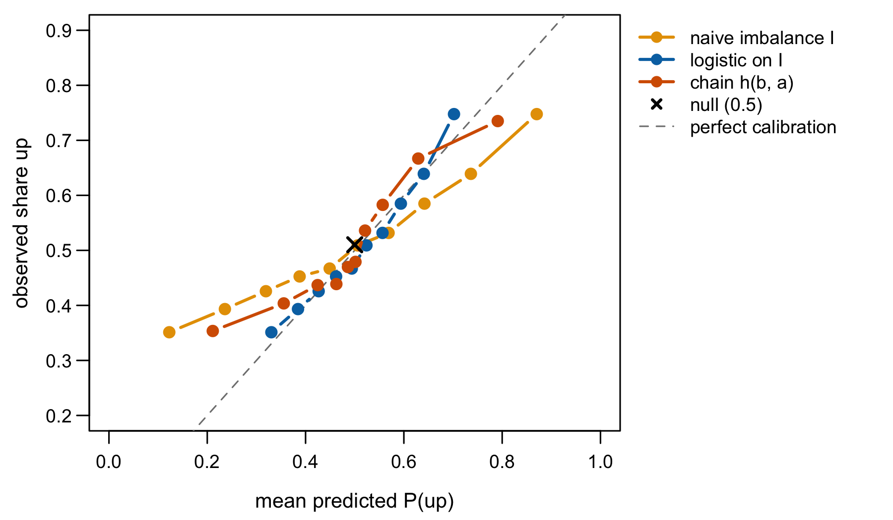

# Predicting the Next Price Move from the Order Book with an Absorbing Markov Chain

When the bid-ask spread is one tick, a stock's price moves only when the queue at the best bid or the best ask runs out. This project models the two queues as an absorbing Markov chain (a two-dimensional Gambler's Ruin) and asks how well it predicts whether the next price move is up. On 7 held-out days of Microsoft (MSFT) order book data, the one-parameter chain, which is never fitted to price moves, beats the naive queue-imbalance rule on every day and comes within 0.0023 Brier score of a logistic regression trained on the outcomes.

<p align="center">
  
</p>

## Results

Test days (18-26 November 2014), 137,160 samples. Lower Brier and log loss are better. The last two columns give the chain's Brier score minus each other predictor's (negative favours the chain), with a 95% interval from a bootstrap over whole test days.

| Predictor | Brier | Log loss | AUC | Chain − this | 95% CI |
|---|---|---|---|---|---|
| Null (always 0.5) | 0.2500 | 0.6931 | 0.500 | −0.0107 | [−0.0150, −0.0067] |
| Naive imbalance b/(b+a) | 0.2488 | 0.7042 | 0.629 | −0.0096 | [−0.0128, −0.0063] |
| **Markov chain h(b, a)** | **0.2393** | **0.6737** | **0.628** | | |
| Logistic regression on imbalance | 0.2370 | 0.6664 | 0.629 | +0.0023 | [+0.0005, +0.0042] |

## Key findings

- **The chain beats the naive imbalance rule on all 7 test days**, and the null predictor too. It removes about 4% of the null predictor's error, against under 1% for the naive rule.
- **The logistic regression is slightly better** (by 0.0023 Brier) and wins on 6 of the 7 days. It has two parameters chosen to predict the outcome; the chain has one, estimated only from counts of queue changes.
- **Event independence (A1) and one-unit steps (A4) are the assumptions the data break most.** After a removal, the next event is an addition on the same side half the time, against 0.28 under independence (Cramér's V = 0.27). Only half of all queue changes are one unit, and a queue that empties loses a median of 1,500 shares at once.
- **Breaking A4 alone explains little of the chain's miscalibration.** In a simulation with real event sizes but independent events, the chain stays almost perfectly calibrated: the reliability term of the Brier score is 0.0002, against 0.0115 on the real data at the same unit size.

## Method

- **Model.** The state is (b, a), the sizes of the best-bid and best-ask queues in units of 100 shares, capped at K = 155. Each event adds or removes one unit on one side, with probabilities (α, β, α, β). The absorbing states U and D are the ask or the bid emptying.
- **Solver.** h(b, a), the probability of absorption in U, comes from the fundamental-matrix identity H = NR with N = (I − Q)⁻¹. Q is stored as a sparse matrix (24,025 transient states, at most four non-zeros per row), and (I − Q)H = R is solved directly, without inverting. `R/tests.R` checks the solver against hand-solved cases, the 1D Gambler's Ruin formula and Monte Carlo.
- **Estimation.** α̂ is the maximum likelihood estimate from event counts on the first 11 trading days, corrected for the removals hidden inside price moves. α̂ = 0.2572, 95% CI [0.2566, 0.2579].
- **Evaluation.** The book is sampled every second at a one-tick spread, and the outcome is the direction of the next mid-price change. Four predictors are compared on the last 7 days with Brier score, log loss, AUC and a calibration plot. Uncertainty comes from a 2,000-draw bootstrap over whole days, because samples within a day are dependent. Each assumption is then tested directly, and a small simulation measures what breaking one of them costs.

## Data

The data accompany Cartea, Jaimungal & Penalva (2015), *Algorithmic and High-Frequency Trading* (Cambridge University Press), and are free to download from the [authors' data page](https://sebastian.statistics.utoronto.ca/books/algo-and-hf-trading/data/).

1. Download and unzip [Nov-2014.zip](http://utstat.utoronto.ca/sjaimung/data/Nov-2014.zip).
2. Copy the 18 `MSFT_*.mat` files (2014-11-03 to 2014-11-26, 100 ms snapshots of the best bid and ask) into `data/raw/`.

**The raw data are not included in this repository.** Intermediate files in `data/processed/` are rebuilt by the scripts. The small result files in `output/` are committed, so the report knits without the data.

## How to reproduce

From the project root:

```sh
Rscript setup.R                      # installs the R packages (and TinyTeX if no LaTeX is found)
for s in R/0[1-6]_*.R; do Rscript "$s"; done
Rscript R/tests.R                    # should end with "35 passed, 0 failed"
Rscript -e 'rmarkdown::render("report/report.Rmd")'
```

Knitting from the command line needs pandoc on the path. RStudio ships its own copy, so **Knit** works there out of the box.

## Repository structure

```
R/
  model.R            chain definition and sparse absorption solver
  tests.R            solver tests
  01_parse.R         read the .mat files, keep 10:00-15:30, clean
  02_events.R        classify each 100 ms interval into queue events
  03_estimate.R      train/test split, estimate alpha and beta, build samples
  04_validate.R      score the four predictors; sensitivity; day bootstrap
  05_assumptions.R   test the chain's assumptions
  06_simulation.R    sanity run and the A4 simulation
output/              result tables (.csv, .rds) and figures (.png)
report/              report.Rmd and the knitted report.pdf
notes/decisions.md   log of modelling choices and why they were made
data/raw/            the .mat files go here (not included)
data/processed/      rebuilt by the scripts (not included)
setup.R              package installation
```

## Report

The full write-up, with the theory, derivations, assumption tests and all code, is in [report/report.pdf](report/report.pdf).

## Credits

Group project for STA348 (Stochastic Processes), University of Toronto Mississauga, Fall 2026, with Shazia Aura Fathraya and Niluh Catherine Regina. Sadman Shayan wrote the code.

**Tech:** R, data.table, Matrix, R Markdown.

The code is released under the [MIT License](LICENSE).
